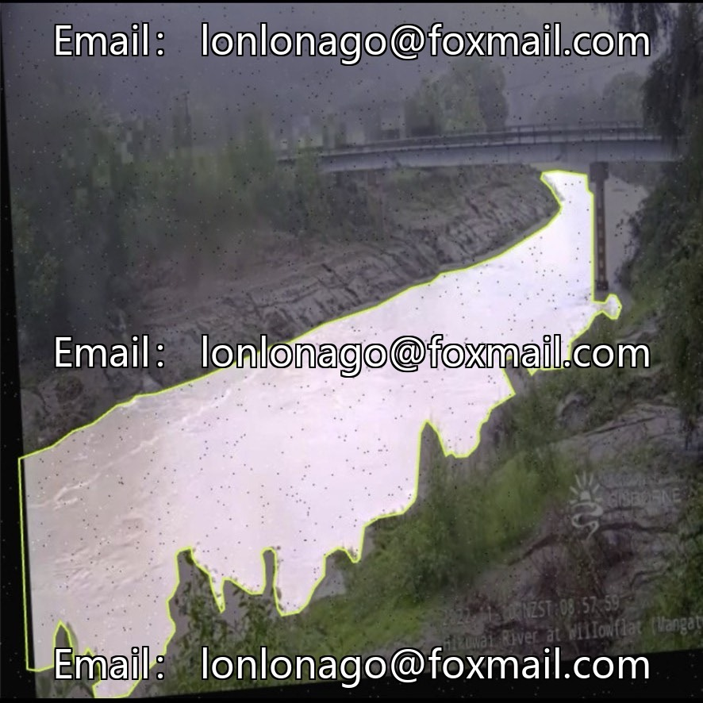
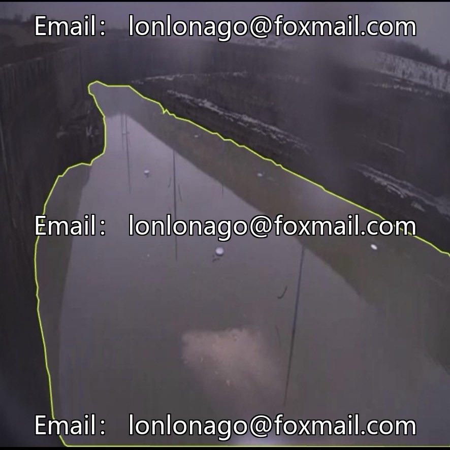
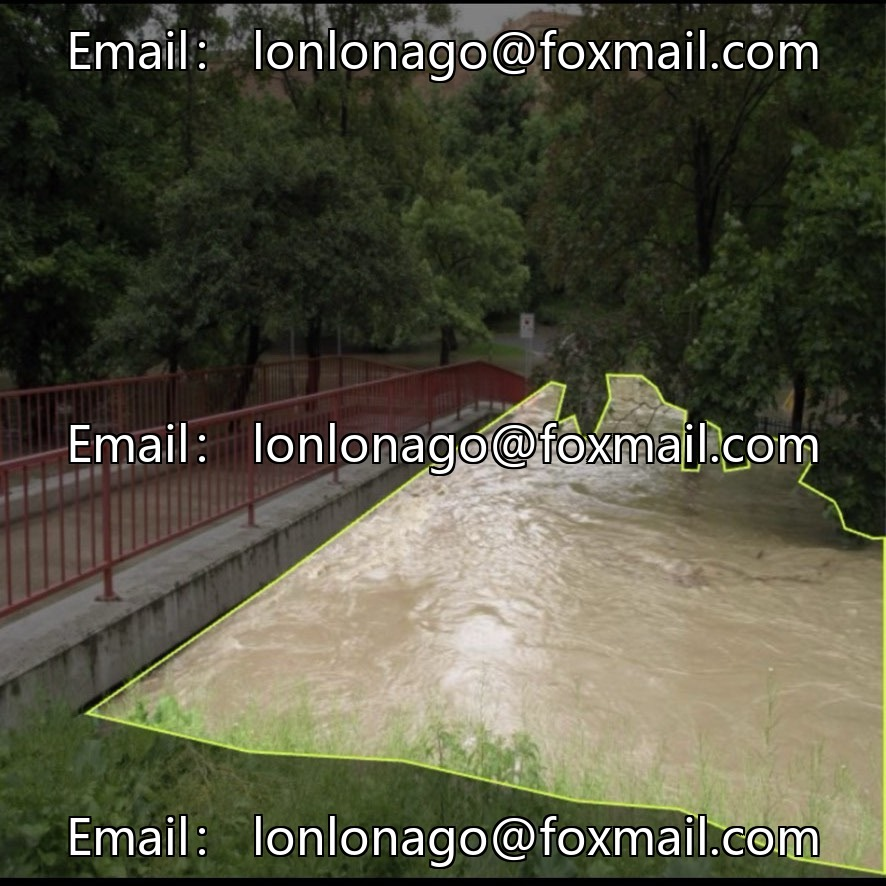
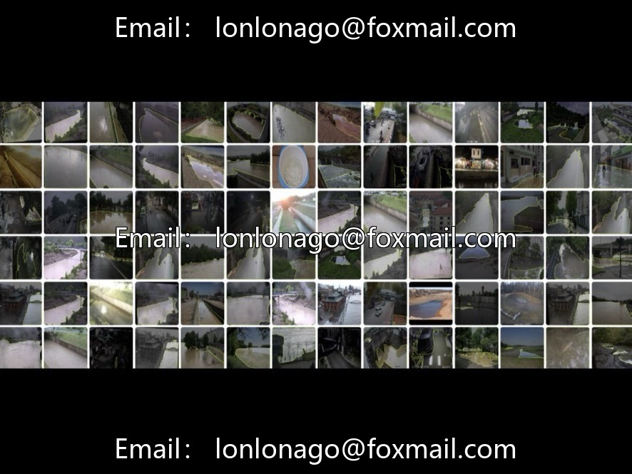

# Drone River Inspection and Identification Dataset, Issue 10700, 7100 Images, package

## Body

Drone River Inspection and Identification Dataset, Issue 10700, 7100 images. Includes drone aerial photography of flood segmentation and water surface segmentation. Supports VOC+COCO+YOLO format. Suitable for training, tuning, and deployment of water body instance segmentation models. Data focuses on the outline and boundary extraction of water bodies, labeled in YOLO format. Can be directly used by mainstream segmentation models without additional conversion, with low engineering development costs.

The dataset is suitable for monitoring flood disasters, river inspection, water resource control and other scenarios, to enhance the level of intelligence in water environment.

Virtual materials, once sold, are non-refundable.
Interested friends, click "I want" to proceed.

## Images

## Payment

Here is a pay link on Stripe ( https://buy.stripe.com/3cs8yP7sY87d0vu9AB ). Please contact me lonlonago@foxmail.com after funding $89, and I will send you a complete data files , thank you!

